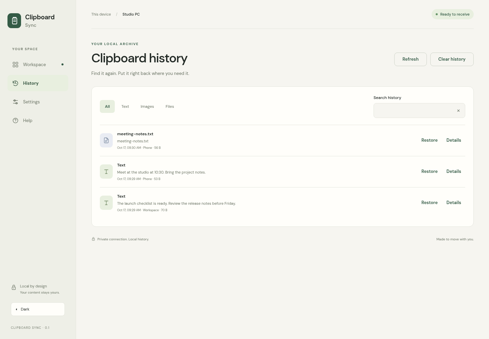

# Clipboard Sync

Send text, images and files from a phone to the Windows clipboard. Save supported clipboard changes in a local Git repository and sync computers through a self-hosted realtime relay.

[Download for Windows](https://github.com/Ding-Ding-Projects/clipboard-sync/releases/latest) · [Interactive guide](https://ding-ding-projects.github.io/clipboard-sync/) · [Build status](https://github.com/Ding-Ding-Projects/clipboard-sync/actions)

## Start on Windows

1. Download **ClipboardSync.exe** for portable use, or **ClipboardSync-Setup.exe** for a per-user installation.
2. Run it and keep the receiver window open. The local browser workspace opens automatically.
3. Complete setup and allow access on your private network when Windows asks.
4. Scan its QR code from your phone on the same Wi-Fi.
5. Send something, then paste on Windows with **Ctrl+V**.

The executable and installer are unsigned. Git is bundled. **ClipboardSync-Guide.exe** provides the complete guide offline.

## Local clipboard history

The receiver checks supported clipboard changes about every 400 milliseconds. Text, bitmap images and ordinary files are committed to the local Git repository at **%LOCALAPPDATA%/ClipboardSync/history**. Search, inspect, download, or restore entries in History.

History is never pushed to a server. Settings and credentials stay outside Git history. Clearing visible entries retains older commits and is not secure erasure. History can contain sensitive copied content; pause capture when needed.

## Sync multiple computers

Run **host.bat --detached** on a Docker host. It creates a protected local .env token, builds the included server, starts Compose, and verifies health. **host.bat --logs** opens keyboard-controlled logs; add **--pull** to use the published image.

Published image: **ghcr.io/ding-ding-projects/clipboard-sync-server:latest**

On each computer, enable sync in Settings with the same base server URL, room, and server token. The relay forwards live events in memory without storing clipboard content. Event identities and sequence handling prevent echo loops. Each receiver keeps its own Git history.

On other Docker hosts, create a local .env containing a random SERVER_TOKEN of at least 32 characters and run **docker compose up -d --build**. Never commit that file. Use HTTPS/WSS through a reverse proxy outside a trusted LAN.

## Build

Run **build.bat /s** and **build-installer.bat /s** on Windows. These entrypoints obtain missing project-local Python, Node and portable Git, verify pinned download checksums, install dependencies and build the artifacts. The installer uses Inno Setup and a per-user destination. No administrator rights are required for these user-scoped tools.

Without /s, the build offers to launch after success. **start.bat** builds if needed and opens the receiver.

For Linux development, install requirements.txt and server-requirements.txt with pip, then run **npm ci**, **npm run build**, and **python -m unittest discover -s tests -v**. Run **python -m receiver --headless --no-browser** to test HTTP and local Git behavior. Headless mode never claims native Windows clipboard success.

## Documentation and API

The [guide](https://ding-ding-projects.github.io/clipboard-sync/) contains setup, phone transfers, history, sync, hosting, privacy, troubleshooting, the complete API reference, development and the project wiki. The same articles are bundled offline.

- [API contract](CONTRACT.md) and [Postman collection](docs/api.postman_collection.json)
- [Receiver notes](receiver/README.md)
- [Interface and evidence](design/interface.md)
- [Browser verification receipt](docs/verification.json)

## Boundaries and evidence

Supported: Unicode text, bitmap images and ordinary files. Binary items are limited to 25 MiB; text to 100,000 characters. Directories, proprietary formats and changes between polling ticks are not captured. Unsupported captures produce warnings. Sync forwards live changes without offline replay; simultaneous changes resolve by arrival order.

Tests cover access control, validation, local Git persistence, watcher simulation, malformed-message recovery, relay forwarding, room isolation and two real receivers syncing through the relay. A non-root Docker container and Compose health/forwarding were exercised. Actual built browser checks and genuine captures are in **design/evidence/**.

Windows clipboard behavior, firewall setup, installer operation and fresh-machine acceptance require separate Windows execution. Linux and browser checks do not establish those results.
